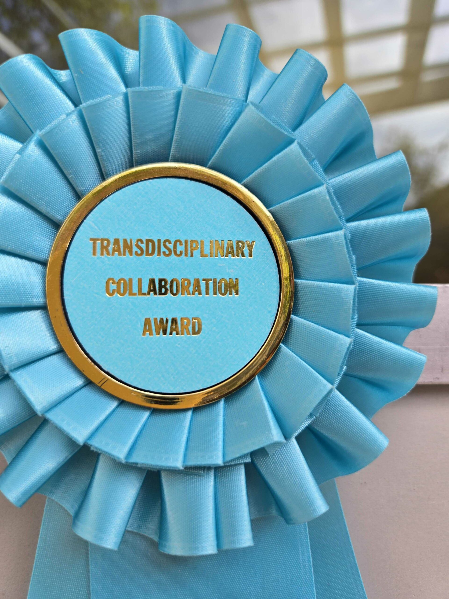

<figure class="image">
  
  <figcaption>The Transdisciplinary Collaboration Award from the 2024 Jacobs School of Engineering Research Expo.</figcaption>
</figure>

FishSense took home the inaugural Transdisciplinary Collaboration Award at the [2024 Jacobs School of Engineering Research Expo](https://jacobsschool.ucsd.edu/research-expo/). That one is on top of a [CA CARES research award](https://innovation.ucsd.edu/about-oic/ca-cares-funds/2024-grant-awardees.html) and a finalist spot in the [Triton Innovation Challenge](https://today.ucsd.edu/story/triton-innovation-challenge-spotlights-trailblazing-environmental-solutions).

The collaboration award feels especially fitting. FishSense only works because it spans [Engineers for Exploration](https://e4e.ucsd.edu/), the [Semmens Lab](https://semmenslab.org/) at [Scripps Institution of Oceanography](https://scripps.ucsd.edu/), and the citizen scientists at [REEF](https://reef.org/), with engineers, ecologists, and divers each bringing a piece. Together, those pieces make a fisheries assessment tool that pairs a commercial dive camera and an underwater laser with optics and machine learning to estimate fish length and biomass automatically.

Congrats to Kyle, Avik, and the rest of the team.

*This post is mirrored from [Professor Ryan Kastner's website](https://kastner.ucsd.edu/fishsense-wins-transdisciplinary-collaboration-award/).*
