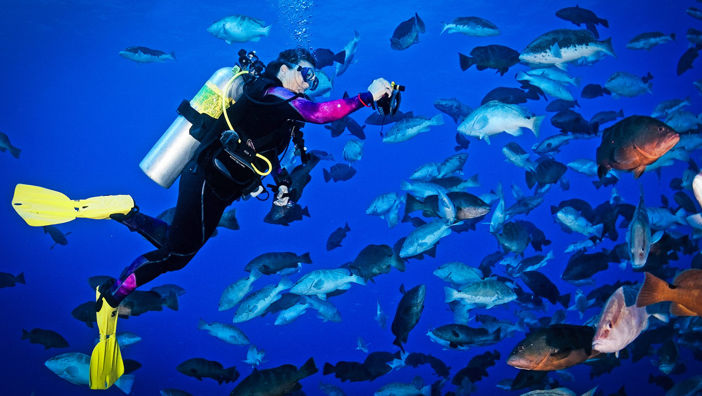

<figure class="image">
  
  <figcaption>A diver uses FishSense to measure the length of a Nassau grouper during Grouper Moon, an annual monitoring dive. Photo by Stacey Henderson, courtesy of REEF.</figcaption>
</figure>

"This would keep the fish out of water for less time."

That's me in [UC San Diego Today](https://today.ucsd.edu/story/student-developed-fishsense-project-collects-data-with-one-click), talking about the iPhone and iPad app we spent this summer building. Katherine Connor's story, which first ran in the fall 2024 issue of *UC San Diego Magazine*, covers both halves of FishSense.

Underwater, divers with our camera and laser can photograph a fish and get its length, no ruler or eyeballing required. We're working with [REEF](https://www.reef.org/), which runs the world's largest scuba diving citizen science program, to get these into volunteers' hands.

On deck, the app uses the LiDAR built into Pro iPhones and iPads to measure a fish from a single photo. A team of undergraduates from the Research Experience for Undergraduates and International Summer Research programs worked on it with me, and our students took it out on several California Collaborative Fisheries Research Program cruises, where marine biologists used it while surveying marine protected areas. Measuring from a photo instead of a board means less time out of the water for each fish.

The story also looks ahead to species detection and individual fish identification, building on the [Semmens Lab](https://semmenslab.org/)'s fish recognition work, which could someday replace physical tags.
