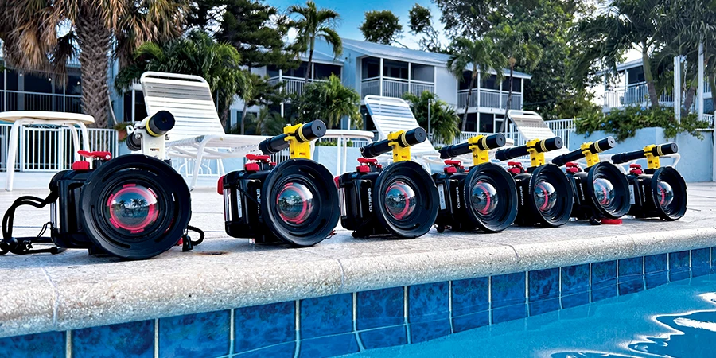

<figure class="image">
  
  <figcaption>FishSense-Lite cameras are calibrated and tested in the pool for REEF's SMILE project. © Reef Environmental Education Foundation</figcaption>
</figure>

For more than 30 years, [REEF](https://www.reef.org/) volunteers have been writing down which fish they see on their dives and how many. That's over 300,000 surveys from more than 18,000 divers, and the data have been used in more than 130 scientific papers. The one thing those surveys couldn't capture was size. A school of juveniles and a group of adults look the same on a tally sheet.

That's the gap SMILE (Size Matters: Innovative Length Estimates) is meant to fill, and it runs on FishSense-Lite. Dr. Alli Candelmo, REEF's Director of Conservation Science, wrote about it in the Q1 2025 issue of *Alert Diver*: ["Advancing Conservation Through Citizen Science"](https://dan.org/alert-diver/article/advancing-conservation-through-citizen-science/).

A diver points the laser at the side of a fish, takes a burst of photos, and software measures the fish from the images. The current setup is an Olympus TG-6, a green laser, and a 3D-printed mount from our team at [Engineers for Exploration](https://e4e.ucsd.edu/) and Scripps. SMILE is targeting 11 species, including big groupers, snappers, hogfish, and parrotfish, and has been tested in the Florida Keys, the Caribbean, and off Mexico's Pacific coast. REEF is also working with Backscatter on a rechargeable, dual-laser version that should fit nearly any camera.

The article also covers Grouper Spotter, which recognizes individual groupers by their markings. Pair that with SMILE, and you could watch a single fish grow over the years.

REEF is still looking for divers to help test SMILE in the Florida Keys. If that sounds like you, [get in touch with them](https://www.reef.org/).
